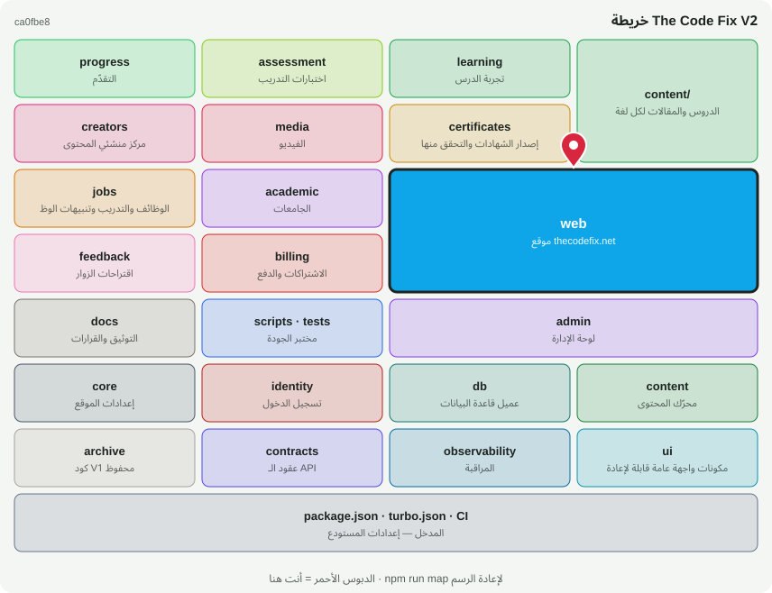

# 🏛️ @tcf/web

تطبيق · موقع thecodefix.net (Next.js)

<!-- map:start (generated by `npm run map` — edits inside are overwritten) -->
## 📍 أنت هنا

| | |
|---|---|
| النوع | تطبيق |
| المكان | `apps/web` |
| يعتمد على | `@tcf/academic`، `@tcf/admin`، `@tcf/assessment`، `@tcf/billing`، `@tcf/certificates`، `@tcf/content`، `@tcf/contracts`، `@tcf/core`، `@tcf/creators`، `@tcf/db`، `@tcf/feedback`، `@tcf/identity`، `@tcf/jobs`، `@tcf/learning`، `@tcf/observability`، `@tcf/progress`، `@tcf/ui` |
| يستخدمه | `tests` |
| الحجم | 149 ملف · 16,064 سطر |
| ملاحظات الفحص | 🟠 1 🟡 1 |

### شو فيه

| المجلد | ملفات | ملاحظة |
|---|---:|---|
| `apps/web/src/app/admin` | 43 | كل صفحة تفحص صلاحيتها بنفسها |
| `apps/web/src/app (root)` | 11 | layout.tsx، الصفحة الرئيسية، sitemap، robots، صفحات الخطأ |
| `apps/web/src/app/academic` | 7 |  |
| `apps/web/src/app/learn` | 5 | /learn ← /learn/[tech] ← /learn/[tech]/[lesson] |
| `apps/web/src/shell` | 11 | الهيدر، الفوتر، القوائم، لوحة الأوامر |
| `apps/web (config)` | 19 | next.config · tsconfig · postcss · package.json |
| `apps/web/src/app/api` | 11 | auth، checkout، stripe webhook، csp-report، و/api/v1 للموبايل |
| `apps/web/src/app/creators` | 11 |  |
| `apps/web/src/app/reference` | 3 |  |
| `apps/web/src/app/jobs` | 2 |  |
| `apps/web/src/app/blog` | 4 |  |
| `apps/web/src/app/roadmaps` | 2 |  |
| `apps/web/src/app/training` | 2 |  |
| `apps/web/src/app/quiz` | 1 |  |
| `apps/web/src/app/verify` | 2 |  |
| `apps/web/src/app/login` | 2 |  |
| `apps/web/src/app/playground` | 1 |  |
| `apps/web/src/app/privacy` | 1 |  |
| `apps/web/src/app/pricing` | 1 |  |
| `apps/web/src/app/terms` | 1 |  |
| `apps/web/src/server` | 1 | طبقة /api/v1 |
| `apps/web/src/app/leaderboard` | 1 |  |
| `apps/web/src/app/certificate` | 1 |  |
| `apps/web/src/app/about` | 1 |  |
| `apps/web/src/app/contact` | 1 |  |
| `apps/web/src/app/search` | 1 |  |
| `apps/web/src/app/account` | 1 |  |
| `apps/web/src/instrumentation` | 1 |  |
| `apps/web/src/types` | 1 | تعريفات أنواع عامة (ambient) |

### الأكثر استخدامًا من الخارج

| الاستيراد | عدد المستوردين |
|---|---:|
| `@tcf/web/app/quiz/[tech]/page` | 1 |
| `@tcf/web/app/certificate/[tech]/page` | 1 |
| `@tcf/web/app/api/v1/tracks/route` | 1 |
| `@tcf/web/app/api/v1/tracks/[track]/route` | 1 |
| `@tcf/web/app/api/v1/tracks/[track]/lessons/[lesson]/route` | 1 |
| `@tcf/web/app/verify/[certificateId]/page` | 1 |
| `@tcf/web/app/api/checkout/route` | 1 |
| `@tcf/web/app/api/stripe/webhook/route` | 1 |

اسأل الخريطة عن أي ملف: `node scripts/audit/where.mjs <اسم الملف>`
<!-- map:end -->
