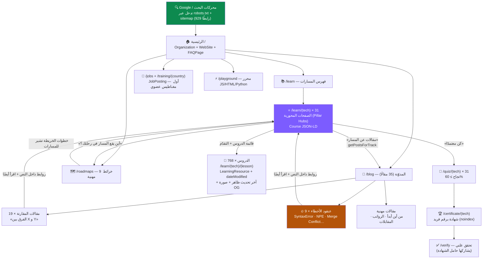
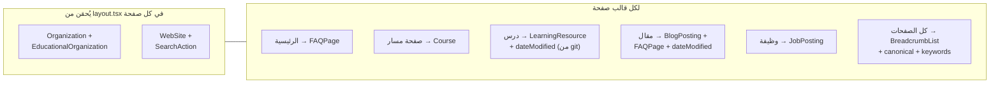
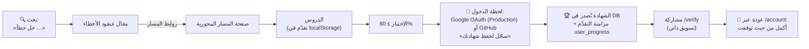

# 🌳 هيكل موقع The Code Fix — الخريطة المعمارية

> وثيقة مرجعية لبنية الموقع والربط الداخلي وطبقة SEO ورحلة الزائر.
> آخر تحديث: **2026-07-08** (بعد دفعة الصفحات المحورية + تواريخ الدروس + عنقود الأخطاء).
> GitHub يعرض مخططات Mermaid أدناه تلقائيًا. الأرقام الحية: 929 رابطًا في sitemap.

---

## 1) الشجرة الكاملة: من الجذر إلى الأوراق

**قراءة المخطط:** الصفحات المحورية (البنفسجية) هي مفترق الطرق — كل مسار يجمع
دروسه + خرائطه + مقالاته + اختباره بروابط وصفية في الاتجاهين. هذا يجعل الـ431
صفحة المفهرسة جسورًا تقود زاحف جوجل إلى الـ371 المنتظرة.

## 2) طبقة SEO — ماذا يقرأ جوجل فوق كل قالب؟

- **noindex** مقصود على: `/account`، `/login`، `/certificate/*` (صفحات شخصية)، `/search`.
- تواريخ الدروس تُولَّد من git بأمر `npm run dates:generate` → `src/content/lesson-dates.json`.
- تدقيق 2026-07-08: SEO **100/100** على كل القوالب، وكل كتل JSON-LD تُقرأ بلا أخطاء.

## 3) رحلة الزائر ونظام المستخدم (OAuth في الإنتاج)

نقطة الدخول التحويلية: **بعد النجاح بالاختبار** (SignInToSaveCert) — أعلى لحظة
حافز. الدخول متاح للجمهور منذ 2026-07-08 (شاشة موافقة Google في Production).

## 4) خارج الشجرة (مساندة)

| المنطقة | الدور |
|---------|-------|
| `/admin/*` (8 أقسام + عمليات) | إدارة المحتوى/المستخدمين/SEO — محجوبة robots + RBAC |
| `/api/*` | auth، checkout، webhook، صور OG — محجوبة robots |
| `/about`، `/contact`، `/pricing`، `/privacy`، `/terms` | صفحات ثقة (تظهر ببحث العلامة) |
| `/search` | بحث فوري — noindex |

> **صيانة الوثيقة:** حدّث الأرقام (المسارات/الدروس/المقالات) عند كل دفعة محتوى
> كبيرة، وأضف أي قسم جديد إلى المخطط الأول.
