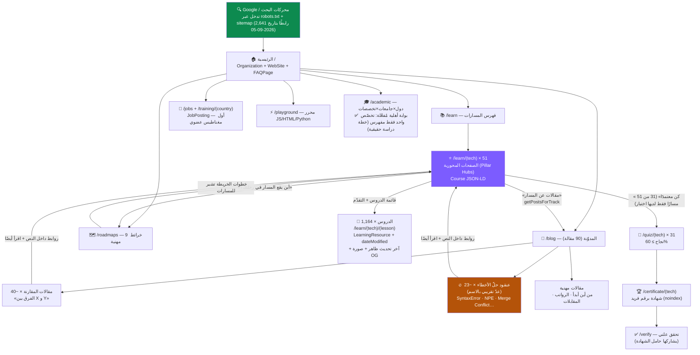
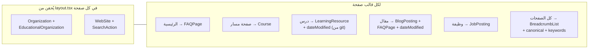

# 🌳 هيكل موقع The Code Fix — الخريطة المعمارية

> وثيقة مرجعية لبنية الموقع والربط الداخلي وطبقة SEO ورحلة الزائر.
> آخر تحديث: **2026-09-05** (تدقيق أرقام — نسخة يوليو كانت تذكر 31 مسارًا/768
> درسًا/929 رابط sitemap، وكلها قديمة، استُبدلت أدناه بأرقام مُتحقَّقة من الريبو
> مباشرة أو من تدقيق منفصل بتاريخ 2026-08-28، بالتصريح بمصدر كل رقم).
> GitHub يعرض مخططات Mermaid أدناه تلقائيًا. **الأرقام الحيّة**: 51 مسارًا،
> 1,164 درسًا، 90 مقالة مدوّنة (تحقّق مباشر 2026-09-04). **رقم sitemap الحي
> الحالي: 2,641 رابطًا بتاريخ 2026-09-05**، منها **رابط تخصّص أكاديمي واحد
> فقط** — بوابة أهلية الفهرسة الأكاديمية (`isStudyPlanPublishable`) **منفَّذة
> ومُتحقَّق منها**: لا تدخل صفحة `/academic/<دولة>/<جامعة>/<تخصص>` الـ sitemap
> إلا بخطة دراسة حقيقية منشورة لتلك الجامعة تحديدًا. **سياق تاريخي فقط:**
> تدقيق منفصل بتاريخ 2026-08-28 (قبل تفعيل البوابة) كان قد رصد 3,636 رابطًا
> إجماليًّا و1,038 صفحة تخصّص بمحتوى احتياطي مشترك — راجع `seo-strategy.md` §0.

---

## 1) الشجرة الكاملة: من الجذر إلى الأوراق

**قراءة المخطط:** الصفحات المحورية (البنفسجية) هي مفترق الطرق — كل مسار يجمع
دروسه + خرائطه + مقالاته + اختباره (إن وُجد) بروابط وصفية في الاتجاهين.
عدد الصفحات **المفهرسة فعليًّا** مقابل **المنتظرة** يتطلّب تصدير Google Search
Console حيّ — **TBD، يحتاج تصدير من المالك** (لا بيانات GSC حيّة متاحة بهذا
التدقيق؛ راجع `docs/seo-baseline-template.md`). الرقمان القديمان (431/371) كانا
من نسخة يوليو ولا يُعتمَد عليهما.

## 2) طبقة SEO — ماذا يقرأ جوجل فوق كل قالب؟

- **noindex** مقصود على: `/account`، `/login`، `/certificate/*` (صفحات شخصية)، `/search`.
- تواريخ الدروس تُولَّد من git بأمر `npm run dates:generate` → `src/content/lesson-dates.json`.
- تدقيق 2026-07-08 (تاريخي): SEO 100/100 على القوالب حينها. تدقيق أحدث
  ومستقل بتاريخ 2026-08-28 (تاريخي أيضًا — `reports/seo-spam-audit-2026-08-28/`،
  إن بقي موجودًا) وجد 12/12 فحص آلي نظيف عبر 1,399 ملف محتوى، لكن رصد خطر
  **duplication/doorway عالي الخطورة** بصفحات `/academic` (1,038 صفحة حينها)
  و**229 صفحة بعنوان `<title>` يتجاوز 60 حرفًا**. **تحديث 2026-09-05**: كلا
  الخطرين عولجا وتحقّقنا منهما. بوابة `isStudyPlanPublishable` تمنع أي صفحة
  تخصّص بلا خطة دراسة حقيقية من دخول الـ sitemap (رابط واحد فقط اليوم)، وتشغيل
  `npm run seo:title-audit` أعطى 0/1,164 عنوان درس و0/90 عنوان مقال فوق 60 حرفًا
  (متوسط 40 للدروس و49 للمقالات).

## 3) رحلة الزائر ونظام المستخدم (OAuth في الإنتاج)

نقطة الدخول التحويلية: **بعد النجاح بالاختبار** (SignInToSaveCert) — أعلى لحظة
حافز. الدخول متاح للجمهور منذ 2026-07-08 (شاشة موافقة Google في Production).

## 4) خارج الشجرة (مساندة)

| المنطقة | الدور |
|---------|-------|
| `/admin/*` (أقسام كثيرة، راجع `PROJECT.md` §9) | إدارة المحتوى/المستخدمين/SEO/العمليات/المبدعين — محجوبة robots + RBAC |
| `/api/*` | auth، checkout، webhook، صور OG، وتجميع تقارير الأخطاء/CSP — محجوبة robots |
| `/about`، `/contact`، `/pricing`، `/privacy`، `/terms` | صفحات ثقة (تظهر ببحث العلامة) |
| `/search` | بحث فوري — noindex |

### الحماية التشغيلية المشتركة

- `src/instrumentation.ts` يلتقط أخطاء Next.js غير المعالجة، وحدود الخطأ
  العامة/الإدارة/root تعرض fallback عربيًا دون كشف رسالة الاستثناء الخام.
- سجلات `[monitoring]` تمر عبر تنقيح للبيانات الحساسة؛ webhook التنبيه اختياري
  ويصبح نشطًا فقط عند ضبط `ERROR_ALERT_WEBHOOK_URL` في بيئة الخادم.
- `Content-Security-Policy-Report-Only` يراقب الانتهاكات دون حجب الموارد، وترسل
  المتصفحات التقارير إلى `/api/csp-report` المحدود بالحجم والمعدل. لا يتحول
  إلى enforcement قبل نافذة المراقبة والقرار المعماري الموثقين في
  `production-monitoring-runbook.md`.
- أفعال الكتابة العامة لها حدود طلب مشتركة مناسبة للمخاطرة، مع إبقاء حدود
  أوسع للمسارات عالية التكرار مثل حفظ التقدم.
- خطة النسخ والاستعادة والتجربة المعزولة موثقة في
  `backup-restore-runbook.md`.

> **صيانة الوثيقة:** حدّث الأرقام (المسارات/الدروس/المقالات) عند كل دفعة محتوى
> كبيرة، وأضف أي قسم جديد إلى المخطط الأول.
