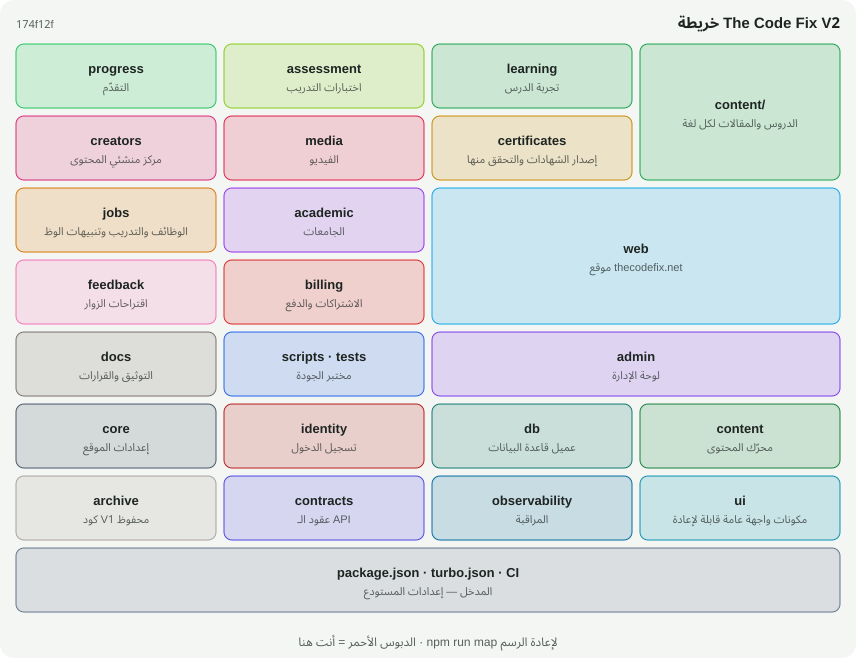
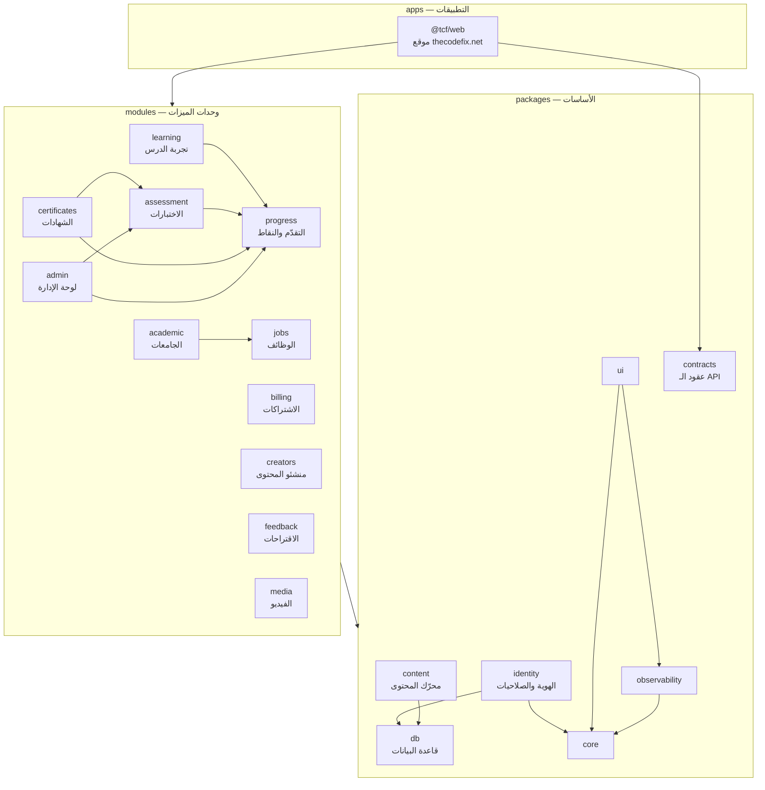
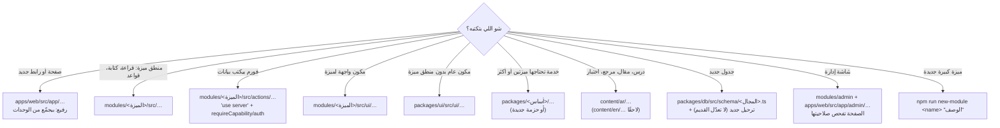

# معمارية The Code Fix — V2

> **الحالة:** مقترحة على فرع `thecodefix-v2` (PR مسودة) — بانتظار مراجعة بشرية قبل الدمج.
> **المبدأ:** V2 تبدأ من رؤية جديدة، لكن مش بالضرورة من كود جديد. احتفظنا بكل إشي سليم من V1، ونقلناه لمكان يسمح للمنصة تكبر.
> **للقراءة السريعة:** [الخريطة](#1-الخريطة-أنت-هنا) ← [القواعد السبع](#3-القواعد-السبع) ← [وين أحط الكود؟](#4-وين-أحط-الكود-الجديد) ← [كيف نكبر](#6-كيف-تكبر-المنصة-بدون-عوائق).

---

## 1) الخريطة: «أنت هنا»



المستودع مقسوم زي مول: **مناطق** (حزم ووحدات) وفيها **محلات** (مجلدات). كل حزمة إلها `README.md` فيه نفس الخريطة مع دبوس أحمر على مكانها (`MAP.svg`)، وجدول بشو فيها، وعلى مين بتعتمد، ومين بيستخدمها.

| وين تلاقي الخريطة | شو هي |
|---|---|
| `docs/project-map/MAP.md` | الخريطة الكاملة كنص: كل منطقة ومحلاتها وملاحظات الفحص |
| `docs/project-map/index.html` | الخريطة التفاعلية: ابحث عن ملف ← دبوس «أنت هنا» ← مين بيستورده وشو بيستورد |
| `<أي حزمة>/README.md` + `MAP.svg` | «أنت هنا» لكل حزمة |
| `node scripts/audit/where.mjs <ملف>` | نفس المعلومات من سطر الأوامر (بدون ما تفتح الملف) |

الخريطة **بتتولّد من الكود نفسه** (`npm run map`) — ما في رسم يدوي يقدر يختلف عن الواقع.

---

## 2) الطبقات الثلاث

```
apps/web  ─►  modules/*  ─►  packages/*  ─►  content/
 (المسارات)    (الميزات)      (الأساسات)       (البيانات)
```



| الطبقة | المكان | المسؤولية | ممنوع |
|---|---|---|---|
| **التطبيق** | `apps/web` | المسارات (URLs)، الهيكل (Header/Footer)، تجميع الوحدات في صفحات، طبقة `/api/v1` | منطق أعمال طويل — مكانه وحدة |
| **وحدات الميزات** | `modules/<name>` | ميزة كاملة: منطق السيرفر، Server Actions، مكونات الواجهة، استعلامات الإدارة | استيراد `apps/web`، أو وحدة ثانية خارج القائمة المسموحة |
| **الأساسات** | `packages/<name>` | خدمات تحتاجها كل ميزة: قاعدة البيانات، الهوية، المحتوى، الواجهة العامة، العقود | استيراد أي وحدة أو تطبيق |
| **المحتوى** | `content/` | بيانات خام: `content/<لغة>/…` للمحتوى التحريري، `content/data/…` للبيانات الحقيقية المحايدة لغويًا | كود |

### الحزم بالأرقام (عند إنشاء V2)

| الحزمة | النوع | ملفات | يعتمد على |
|---|---|---:|---|
| `@tcf/core` | أساس | 10 | — |
| `@tcf/db` | أساس | 81 (منها 30 ترحيل) | — |
| `@tcf/observability` | أساس | 9 | core |
| `@tcf/identity` | أساس | 9 | core، db |
| `@tcf/content` | أساس | 18 | db |
| `@tcf/ui` | أساس | 16 | core، observability |
| `@tcf/contracts` | أساس | 4 | — |
| `@tcf/learning` | وحدة | 19 | content، core، observability، **progress** |
| `@tcf/progress` | وحدة | 18 | content، core، db، identity، observability، ui |
| `@tcf/assessment` | وحدة | 15 | content، core، db، identity، observability، **progress** |
| `@tcf/certificates` | وحدة | 10 | **assessment**، **progress** + أساسات |
| `@tcf/billing` | وحدة | 7 | db، observability |
| `@tcf/creators` | وحدة | 25 | core، db، identity |
| `@tcf/academic` | وحدة | 32 | **jobs** + أساسات |
| `@tcf/jobs` | وحدة | 12 | أساسات |
| `@tcf/feedback` | وحدة | 7 | core، db، identity |
| `@tcf/media` | وحدة (جديدة) | 8 | content |
| `@tcf/admin` | وحدة | 20 | **assessment**، **progress** + أساسات |
| `@tcf/web` | تطبيق | 147 | كل ما سبق |

الأسهم بين الوحدات (بالخط العريض) هي **كل** الاستثناءات المسموحة، وكلها باتجاه واحد — الرسم البياني بين الحزم **بلا دورات**.

---

## 3) القواعد السبع

كل قاعدة هنا **مفروضة باختبار** في `tests/architecture-boundaries.test.mjs` — إذا انكسرت، الـ CI بيفشل. `tsc` ما بيقدر يمسك أي وحدة منها لأن كل مخالفة بتترجم عادي.

1. **الاتجاه واحد:** `apps → modules → packages`. الأساس ما بيعرف عن الميزات، والميزة ما بتعرف عن الموقع.
2. **الوحدة ما بتستورد وحدة ثانية** إلا إذا كانت بقائمة `MODULE_DEPS`، وأي إضافة لها بتحتاج سجل قرار (ADR).
3. **لوحة الإدارة منفصلة منطقيًا:** `@tcf/admin` بيجمّع الوحدات، وما في وحدة بتستورده.
4. **ما في دورات** لا بين الحزم ولا بين الملفات.
5. **`@/` للموقع بس.** الحزم بتستورد بعض بأسمائها: `@tcf/<name>/<file>` أو `@tcf/<name>/ui/<Component>`.
6. **ملفات السيرفر ما بتوصل للمتصفح:** قائمة `SERVER_ONLY` (قاعدة البيانات، الهوية، التشفير، بنك أسئلة الامتحان، Stripe…) ممنوع تكون قابلة للوصول من أي `"use client"` إلا كـ `import type`.
7. **كل حزمة بتعلن اعتمادياتها** في `package.json` (بتتولد بـ `npm run workspaces:sync`)، وإلها `README.md` + `MAP.svg`.

بالإضافة لقواعد V1 اللي بقيت كما هي: كل Server Action بتفحص الصلاحية بنفسها (`requireCapability`)، كل صفحة إدارة بتفحص صلاحيتها (`tests/admin-page-capability-coverage.test.mjs`)، ومصفوفة الصلاحيات (`tests/rbac-matrix.test.mjs`) بتجرب كل Server Action مع كل الأدوار العشرة.

---

## 4) وين أحط الكود الجديد؟



**قاعدة الإبهام:** إذا كودك بيحتاجه **مكانين** أو أكثر، مش مكانه الصفحة. إذا بتحتاجه **ميزتين**، مش مكانه وحدة — مكانه أساس.

---

## 5) شو تغيّر عن V1 وليش

| V1 | V2 | ليش |
|---|---|---|
| كل الكود بـ `src/` بأربع طبقات | `apps / modules / packages` | ميزة جديدة = مجلد جديد، بدون ما تلمس 70 ملف بـ `src/lib` |
| `src/lib` مسطّح (~70 ملف + «متفرقات») | كل ملف بوحدته أو أساسه | كل ملف إله صاحب واضح |
| Server Actions جوّا `src/app` و13 مكون بيستوردها من هناك | كل وحدة بتملك Server Actions تبعها | ما في وحدة بتعتمد على كود المسارات؛ لوحة الإدارة ممكن تصير تطبيق منفصل لاحقًا بدون نقل |
| المحتوى بـ `src/content` مربوط بمجلد التطبيق | `content/<لغة>` + `content/data` + `@tcf/content/paths` | لغات متعددة، وأي تطبيق (API، موبايل، إدارة) بيقرأ نفس المحتوى |
| `drizzle-orm/neon-http` بس — بدون معاملات | + `withTransaction()` من `@tcf/db/transaction` | الاشتراكات والدفع بدهم كتابات «كلها أو لا شيء» (ADR 0004) |
| ما في API للموبايل | `/api/v1/*` + `@tcf/contracts` (zod) | نفس المحتوى، عقد واحد بين السيرفر والتطبيق (ADR 0006) |
| ما في فيديو | `@tcf/media` (YouTube بدون كوكيز، ملفات Vercel Blob) | دورات مصورة بدون ربط المنصة بمزوّد واحد (ADR 0007) |
| Next.js 16.2.11 (ثغرة حرجة) | 16.3.8 | 0 ثغرات حرجة أو عالية بالإنتاج |
| ما في خريطة | خريطة مولّدة + «أنت هنا» لكل حزمة | أي حدا (إنسان أو وكيل) بيعرف وين هو بثواني |

**اللي ما تغيّر (عن قصد):** كل روابط الموقع (3,967 صفحة ثابتة — نفس القائمة حرفيًا)، الـ Schema (نفس الـ SQL، `drizzle-kit generate` = «No schema changes»)، الترحيلات الـ 30 وقفلها، قواعد المحتوى وSEO، وكل فحوصات CI.

---

## 6) كيف تكبر المنصة بدون عوائق

| التوسع | وين بيصير | الحالة |
|---|---|---|
| **مسارات أكثر** | ملفات بـ `content/ar/tracks/<slug>/` — بدون أي كود | ✅ جاهز (نفس V1) |
| **لغة جديدة** | `content/en/…` + تفعيل `en` بـ `@tcf/content/i18n` + مسارات `/en/…` | 🟡 الأساس جاهز (ADR 0005)، المسارات المرحلة 2 |
| **تطبيق موبايل** | `apps/mobile` (Expo) بيستهلك `/api/v1` وبيتحقق بـ `@tcf/contracts` | 🟡 الـ API والعقود جاهزة ومختبرة (ADR 0006) |
| **فيديو** | `@tcf/media` + مزوّد جديد = ملف واحد بـ `providers/` | 🟡 الواجهة والمزوّدات جاهزة؛ الجداول المرحلة 2 (ADR 0007) |
| **اشتراكات شهرية** | `@tcf/billing` + `withTransaction` + جدول خطط/استحقاقات | 🟡 الأساس جاهز؛ التصميم بـ ADR 0008 |
| **حسابات جامعات** | `@tcf/academic` + أدوار جامعية بـ `@tcf/identity` | 🟡 التصميم بـ ADR 0009 |
| **مستخدمين أكثر بكثير** | rate limit موزّع (Redis)، كاش CDN للـ API، معاملات | 🟡 خطة بـ SECURITY.md وROADMAP.md |
| **ميزة جديدة كليًا** | `npm run new-module <name> "<الوصف>"` | ✅ جاهز |
| **لوحة إدارة كتطبيق منفصل** | `apps/admin` بيستورد `@tcf/admin` والوحدات | 🟢 ممكن بدون نقل كود (الوحدات أصلًا مستقلة) |

---

## 7) أدوات V2

| الأمر | شو بيعمل |
|---|---|
| `npm run dev` / `npm run build` | تشغيل/بناء الموقع عبر Turborepo |
| `npm run build:offline` | بناء للتحقق بدون إنترنت (خطوط Google وهمية — لا تنشره) |
| `npm run typecheck` / `npm run lint` / `npm test` / `npm run check:all` | نفس بوابات V1، على كل المستودع |
| `npm run map` | فحص + إعادة رسم الخريطة و«أنت هنا» لكل حزمة |
| `npm run map:branches` | + فحص كل الفروع غير المدموجة |
| `npm run new-module <name> "<وصف>"` | وحدة جديدة كاملة بخطوة وحدة |
| `npm run port-branch <branch>` | نقل فرع V1 قديم لهيكل V2 |
| `npm run workspaces:sync` | تحديث اعتماديات كل `package.json` من الكود |
| `node scripts/v2/mv.mjs <من> <إلى>` | نقل ملف داخل V2 وتحديث كل من يستورده |
| `node scripts/audit/where.mjs <ملف>` | «أنت هنا» من سطر الأوامر |

خريطة الانتقال الكاملة (كل ملف V1 ووين صار): [`MIGRATION.md`](MIGRATION.md).

---

## 8) القرارات المعمارية (ADR)

| # | القرار | الحالة |
|---|---|---|
| [0001](adr/0001-monorepo.md) | Monorepo بـ npm workspaces + Turborepo، حزم «Just-in-Time» بدون خطوة بناء | مقترح |
| [0002](adr/0002-modules-and-boundaries.md) | وحدات ميزات بحدود مفروضة باختبارات؛ فصل الإدارة منطقيًا | مقترح |
| [0003](adr/0003-content-tree.md) | شجرة محتوى مستقلة لكل لغة + بيانات محايدة | مقترح |
| [0004](adr/0004-database-transactions.md) | معاملات حقيقية عبر WebSocket للكتابات الذرّية | مقترح |
| [0005](adr/0005-i18n.md) | العربية بدون بادئة؛ اللغات الأخرى ببادئة؛ 3 مراحل | مقترح |
| [0006](adr/0006-api-for-mobile.md) | `/api/v1` + عقود zod مشتركة | مقترح |
| [0007](adr/0007-video.md) | وحدة فيديو محايدة للمزوّد | مقترح |
| [0008](adr/0008-subscriptions.md) | اشتراكات شهرية واستحقاقات | مقترح |
| [0009](adr/0009-universities.md) | الجانب الأكاديمي: حسابات جامعات | مقترح |
| [0010](adr/0010-server-actions-in-modules.md) | Server Actions بتعيش جوّا الوحدات | مقترح |

---

## 9) النشر

الموقع صار بـ `apps/web`، والمستودع `baraaabusamra/thecodefix.v2`. على Vercel لازم **Root Directory = `apps/web`**. التفاصيل وقائمة التحقق: [`DEPLOYMENT.md`](DEPLOYMENT.md). الأمان والثغرات المتبقية: [`SECURITY.md`](SECURITY.md). الخطوات الجاية: [`ROADMAP.md`](ROADMAP.md).

## 10) فخّين بالـ monorepo (محلولين — لا ترجّعهم)

| الفخ | ليش بيصير | الحل الموجود |
|---|---|---|
| **Tailwind ما بيولّد كلاسات مستخدمة بـ `modules/` و`packages/`** | Tailwind v4 بيفحص مجلد العمل وقت البناء بس (`apps/web`)، والمكوّنات صارت براه. أول ضحية: `prose` بجسم الدرس، فالعناوين والقوائم بتطلع نص عادي | `@import "tailwindcss" source("../../../..")` بـ `apps/web/src/app/globals.css` — بيفحص المستودع كله متل V1. اتأكدنا: كل كلاس بيستخدمه V1 بصفحة حقيقية موجود بـ V2 |
| **`.env.local` بالجذر ما بيوصل للموقع** | Next بيقرأ ملفات `.env*` من مجلد التطبيق بس (`apps/web`) | `apps/web/next.config.ts` بيقرأ ملفات الجذر كمان (بدون ما يكتب فوق أي قيمة موجودة)، فملف `.env.local` واحد بالجذر بيخدم الموقع وسكربتات قاعدة البيانات |
