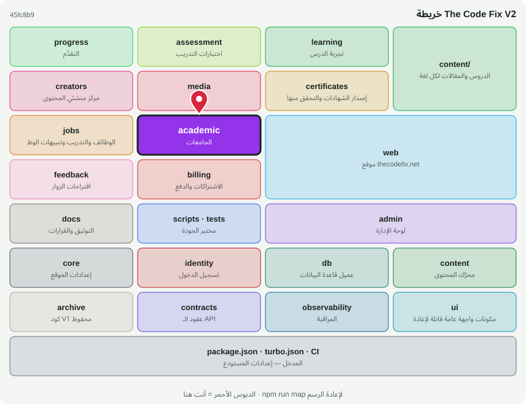

# 🏫 @tcf/academic

وحدة ميزة · الجامعات، الخطط الدراسية، خط استخراج المناهج

<!-- map:start (generated by `npm run map` — edits inside are overwritten) -->
## 📍 أنت هنا

| | |
|---|---|
| النوع | وحدة ميزة |
| المكان | `modules/academic` |
| يعتمد على | `@tcf/content`، `@tcf/core`، `@tcf/db`، `@tcf/identity`، `@tcf/jobs` |
| يستخدمه | `@tcf/web`، `scripts`، `tests` |
| الحجم | 32 ملف · 3,752 سطر |
| ملاحظات الفحص | ✅ لا شيء |

### شو فيه

| المجلد | ملفات | ملاحظة |
|---|---:|---|
| `modules/academic/src/pipeline` | 20 | خط استخراج المناهج: اكتشاف ← جمع ← استخراج ← طابور مراجعة بشرية |
| `modules/academic/src` | 5 | منطق الحزمة (سيرفر ومشترك) |
| `modules/academic/src/ui` | 2 | مكونات الواجهة (React) — تُستورد كـ @tcf/<الحزمة>/ui/<الاسم> |
| `modules/academic/src/actions` | 2 | Server Actions — نقاط HTTP عامة؛ كل واحدة تفحص الهوية والصلاحية بنفسها |
| `modules/academic (package)` | 3 | package.json · README · MAP.svg |

### الأكثر استخدامًا من الخارج

| الاستيراد | عدد المستوردين |
|---|---:|
| `@tcf/academic/universities` | 8 |
| `@tcf/academic/study-plans` | 6 |
| `@tcf/academic/pipeline/extraction/pipeline` | 4 |
| `@tcf/academic/indexability` | 3 |
| `@tcf/academic/courses` | 3 |
| `@tcf/academic/pipeline/jobs/process` | 3 |
| `@tcf/academic/actions/admin-academic` | 2 |
| `@tcf/academic/actions/admin-pipeline` | 2 |
| `@tcf/academic/pipeline/discovery/ranking` | 2 |
| `@tcf/academic/pipeline/extraction/provider` | 2 |
| `@tcf/academic/pipeline/collection/pdf` | 2 |
| `@tcf/academic/pipeline/jobs/claim` | 2 |

اسأل الخريطة عن أي ملف: `node scripts/audit/where.mjs <اسم الملف>`
<!-- map:end -->
