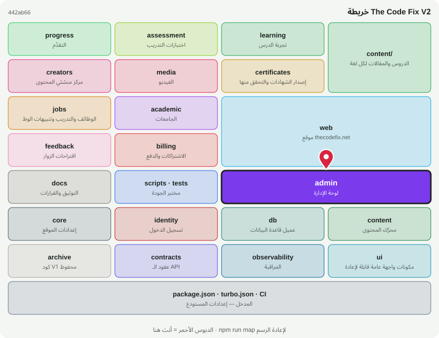

# 🛠️ @tcf/admin

وحدة ميزة · لوحة الإدارة: العمليات، التقارير، المستخدمين، SEO

<!-- map:start (generated by `npm run map` — edits inside are overwritten) -->
## 📍 أنت هنا

| | |
|---|---|
| النوع | وحدة ميزة |
| المكان | `modules/admin` |
| يعتمد على | `@tcf/assessment`، `@tcf/content`، `@tcf/core`، `@tcf/db`، `@tcf/identity`، `@tcf/progress` |
| يستخدمه | `@tcf/web`، `tests` |
| الحجم | 18 ملف · 2,377 سطر |
| ملاحظات الفحص | ✅ لا شيء |

### شو فيه

| المجلد | ملفات | ملاحظة |
|---|---:|---|
| `modules/admin/src` | 8 |  |
| `modules/admin/src/actions` | 8 |  |
| `modules/admin/src/ui` | 1 |  |
| `modules/admin (package)` | 1 |  |

### الأكثر استخدامًا من الخارج

| الاستيراد | عدد المستوردين |
|---|---:|
| `@tcf/admin/operations` | 5 |
| `@tcf/admin/actions/content` | 4 |
| `@tcf/admin/actions/ops-instructors` | 3 |
| `@tcf/admin/users` | 3 |
| `@tcf/admin/actions/ops-content` | 2 |
| `@tcf/admin/actions/ops-tickets` | 2 |
| `@tcf/admin/reports` | 2 |
| `@tcf/admin/ui/AdminCommandPaletteClient` | 1 |
| `@tcf/admin/changelog` | 1 |
| `@tcf/admin/diagnostics` | 1 |
| `@tcf/admin/outreach` | 1 |
| `@tcf/admin/actions/ops-outreach` | 1 |

اسأل الخريطة عن أي ملف: `node scripts/audit/where.mjs <اسم الملف>`
<!-- map:end -->
