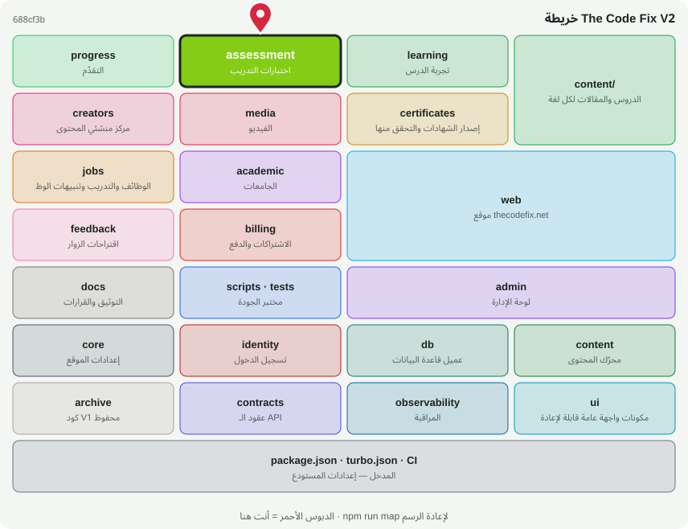

# 📝 @tcf/assessment

وحدة ميزة · اختبارات التدريب، بنك الأسئلة، الامتحان النهائي

<!-- map:start (generated by `npm run map` — edits inside are overwritten) -->
## 📍 أنت هنا

| | |
|---|---|
| النوع | وحدة ميزة |
| المكان | `modules/assessment` |
| يعتمد على | `@tcf/content`، `@tcf/core`، `@tcf/db`، `@tcf/identity`، `@tcf/observability`، `@tcf/progress` |
| يستخدمه | `@tcf/admin`، `@tcf/certificates`، `@tcf/web`، `tests` |
| الحجم | 15 ملف · 1,886 سطر |
| ملاحظات الفحص | ✅ لا شيء |

### شو فيه

| المجلد | ملفات | ملاحظة |
|---|---:|---|
| `modules/assessment/src/actions` | 3 | Server Actions — نقاط HTTP عامة؛ كل واحدة تفحص الهوية والصلاحية بنفسها |
| `modules/assessment/src/ui` | 4 | مكونات الواجهة (React) — تُستورد كـ @tcf/<الحزمة>/ui/<الاسم> |
| `modules/assessment/src` | 4 | منطق الحزمة (سيرفر ومشترك) |
| `modules/assessment (package)` | 3 | package.json · README · MAP.svg |
| `modules/assessment/src/admin` | 1 | استعلامات وأدوات لوحة الإدارة لهذه الوحدة |

### الأكثر استخدامًا من الخارج

| الاستيراد | عدد المستوردين |
|---|---:|
| `@tcf/assessment/quiz-bank` | 15 |
| `@tcf/assessment/requirements` | 6 |
| `@tcf/assessment/actions/exam` | 5 |
| `@tcf/assessment/actions/admin-quizzes` | 3 |
| `@tcf/assessment/actions/lesson-quiz` | 2 |
| `@tcf/assessment/admin/quizzes` | 1 |
| `@tcf/assessment/ui/LessonQuiz` | 1 |
| `@tcf/assessment/ui/QuizRunner` | 1 |
| `@tcf/assessment/ui/ExamRunner` | 1 |

اسأل الخريطة عن أي ملف: `node scripts/audit/where.mjs <اسم الملف>`
<!-- map:end -->
