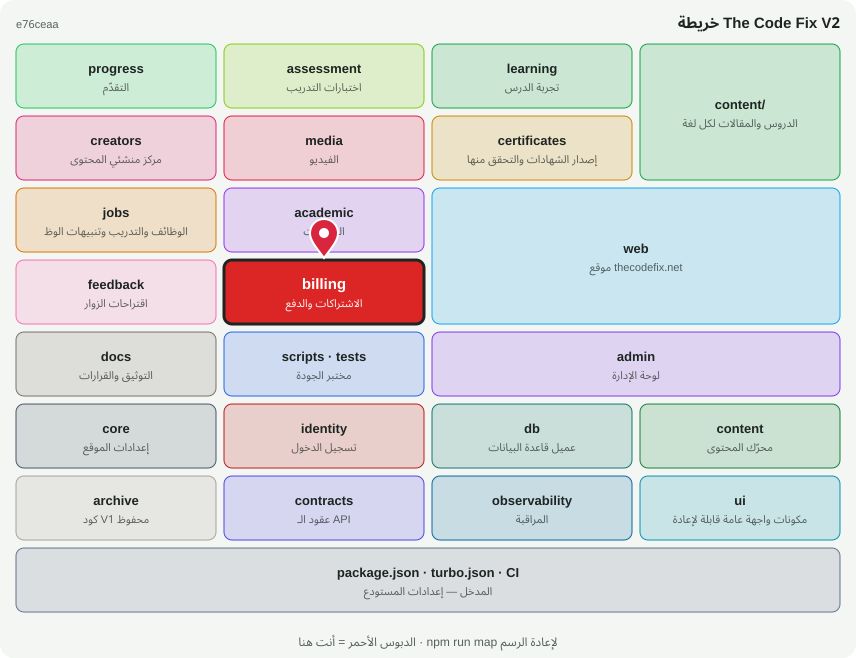

# 💳 @tcf/billing

وحدة ميزة · الاشتراكات والدفع (Stripe)

<!-- map:start (generated by `npm run map` — edits inside are overwritten) -->
## 📍 أنت هنا

| | |
|---|---|
| النوع | وحدة ميزة |
| المكان | `modules/billing` |
| يعتمد على | `@tcf/db`، `@tcf/observability` |
| يستخدمه | `@tcf/web`، `tests` |
| الحجم | 5 ملف · 372 سطر |
| ملاحظات الفحص | ✅ لا شيء |

### شو فيه

| المجلد | ملفات | ملاحظة |
|---|---:|---|
| `modules/billing/src` | 2 |  |
| `modules/billing/src/admin` | 1 |  |
| `modules/billing/src/ui` | 1 |  |
| `modules/billing (package)` | 1 |  |

### الأكثر استخدامًا من الخارج

| الاستيراد | عدد المستوردين |
|---|---:|
| `@tcf/billing/stripe-sync` | 3 |
| `@tcf/billing/stripe` | 2 |
| `@tcf/billing/admin/overview` | 1 |
| `@tcf/billing/ui/SubscribeButton` | 1 |

اسأل الخريطة عن أي ملف: `node scripts/audit/where.mjs <اسم الملف>`
<!-- map:end -->
