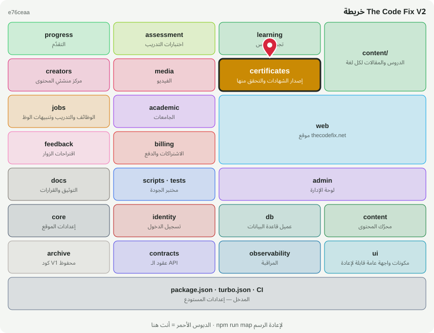

# 🏅 @tcf/certificates

وحدة ميزة · إصدار الشهادات والتحقق منها

<!-- map:start (generated by `npm run map` — edits inside are overwritten) -->
## 📍 أنت هنا

| | |
|---|---|
| النوع | وحدة ميزة |
| المكان | `modules/certificates` |
| يعتمد على | `@tcf/assessment`، `@tcf/content`، `@tcf/core`، `@tcf/db`، `@tcf/identity`، `@tcf/observability`، `@tcf/progress` |
| يستخدمه | `@tcf/web`، `tests` |
| الحجم | 8 ملف · 1,495 سطر |
| ملاحظات الفحص | ✅ لا شيء |

### شو فيه

| المجلد | ملفات | ملاحظة |
|---|---:|---|
| `modules/certificates/src/ui` | 5 |  |
| `modules/certificates/src/actions` | 1 |  |
| `modules/certificates/src` | 1 |  |
| `modules/certificates (package)` | 1 |  |

### الأكثر استخدامًا من الخارج

| الاستيراد | عدد المستوردين |
|---|---:|
| `@tcf/certificates/certificates` | 4 |
| `@tcf/certificates/actions/certificate` | 4 |
| `@tcf/certificates/ui/Certificate` | 1 |
| `@tcf/certificates/ui/SecureCertificate` | 1 |

اسأل الخريطة عن أي ملف: `node scripts/audit/where.mjs <اسم الملف>`
<!-- map:end -->
