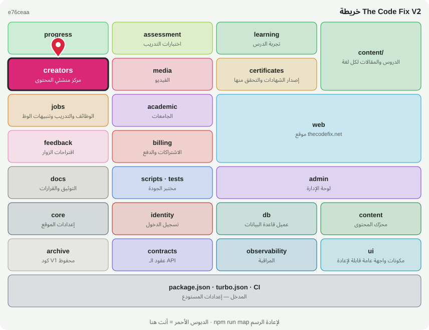

# 🎨 @tcf/creators

وحدة ميزة · مركز منشئي المحتوى

<!-- map:start (generated by `npm run map` — edits inside are overwritten) -->
## 📍 أنت هنا

| | |
|---|---|
| النوع | وحدة ميزة |
| المكان | `modules/creators` |
| يعتمد على | `@tcf/core`، `@tcf/db`، `@tcf/identity` |
| يستخدمه | `@tcf/web`، `tests` |
| الحجم | 25 ملف · 2,264 سطر |
| ملاحظات الفحص | ✅ لا شيء |

### شو فيه

| المجلد | ملفات | ملاحظة |
|---|---:|---|
| `modules/creators/src/ui` | 13 | مكونات الواجهة (React) — تُستورد كـ @tcf/<الحزمة>/ui/<الاسم> |
| `modules/creators/src/actions` | 7 | Server Actions — نقاط HTTP عامة؛ كل واحدة تفحص الهوية والصلاحية بنفسها |
| `modules/creators/src` | 2 | منطق الحزمة (سيرفر ومشترك) |
| `modules/creators (package)` | 3 | package.json · README · MAP.svg |

### الأكثر استخدامًا من الخارج

| الاستيراد | عدد المستوردين |
|---|---:|
| `@tcf/creators/creators` | 12 |
| `@tcf/creators/ui/SubmissionCard` | 2 |
| `@tcf/creators/ui/PageSwitcher` | 2 |
| `@tcf/creators/ui/SubmissionStatusBadge` | 1 |
| `@tcf/creators/actions/admin-creators` | 1 |
| `@tcf/creators/ui/SubmissionReviewPanel` | 1 |
| `@tcf/creators/notifications` | 1 |
| `@tcf/creators/ui/CreatorProfileCard` | 1 |
| `@tcf/creators/ui/EditProfileForm` | 1 |
| `@tcf/creators/ui/CreatorDashboard` | 1 |
| `@tcf/creators/ui/VideoGallery` | 1 |
| `@tcf/creators/ui/CreatorRegisterForm` | 1 |

اسأل الخريطة عن أي ملف: `node scripts/audit/where.mjs <اسم الملف>`
<!-- map:end -->
