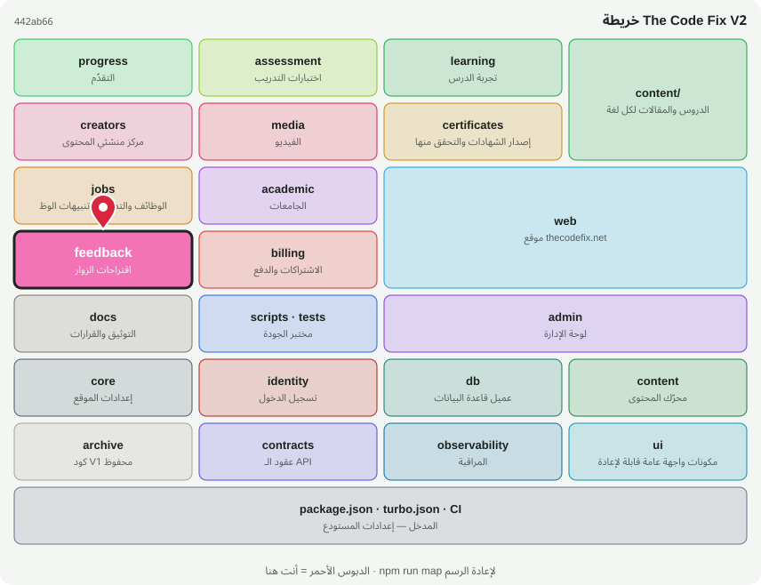

# 💬 @tcf/feedback

وحدة ميزة · اقتراحات الزوار

<!-- map:start (generated by `npm run map` — edits inside are overwritten) -->
## 📍 أنت هنا

| | |
|---|---|
| النوع | وحدة ميزة |
| المكان | `modules/feedback` |
| يعتمد على | `@tcf/core`، `@tcf/db`، `@tcf/identity` |
| يستخدمه | `@tcf/web` |
| الحجم | 7 ملف · 343 سطر |
| ملاحظات الفحص | ✅ لا شيء |

### شو فيه

| المجلد | ملفات | ملاحظة |
|---|---:|---|
| `modules/feedback/src/ui` | 1 | مكونات الواجهة (React) — تُستورد كـ @tcf/<الحزمة>/ui/<الاسم> |
| `modules/feedback/src/actions` | 2 | Server Actions — نقاط HTTP عامة؛ كل واحدة تفحص الهوية والصلاحية بنفسها |
| `modules/feedback (package)` | 3 | package.json · README · MAP.svg |
| `modules/feedback/src/admin` | 1 | استعلامات وأدوات لوحة الإدارة لهذه الوحدة |

### الأكثر استخدامًا من الخارج

| الاستيراد | عدد المستوردين |
|---|---:|
| `@tcf/feedback/admin/suggestions` | 1 |
| `@tcf/feedback/actions/admin-suggestions` | 1 |
| `@tcf/feedback/ui/SuggestBox` | 1 |

اسأل الخريطة عن أي ملف: `node scripts/audit/where.mjs <اسم الملف>`
<!-- map:end -->
