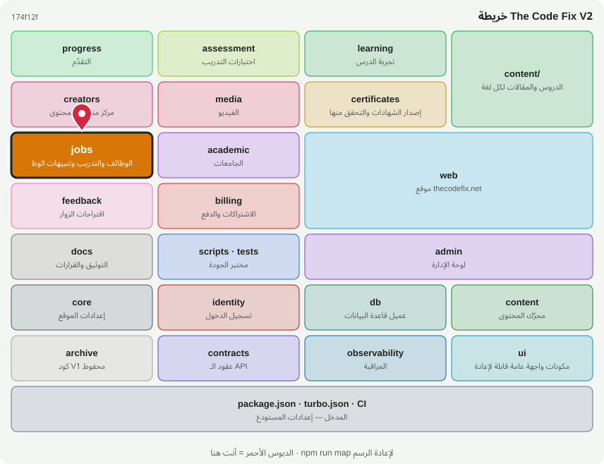

# 💼 @tcf/jobs

وحدة ميزة · الوظائف والتدريب وتنبيهات الوظائف

<!-- map:start (generated by `npm run map` — edits inside are overwritten) -->
## 📍 أنت هنا

| | |
|---|---|
| النوع | وحدة ميزة |
| المكان | `modules/jobs` |
| يعتمد على | `@tcf/content`، `@tcf/core`، `@tcf/db`، `@tcf/identity`، `@tcf/observability`، `@tcf/ui` |
| يستخدمه | `@tcf/academic`، `@tcf/web` |
| الحجم | 12 ملف · 781 سطر |
| ملاحظات الفحص | 🔵 1 |

### شو فيه

| المجلد | ملفات | ملاحظة |
|---|---:|---|
| `modules/jobs/src` | 3 | منطق الحزمة (سيرفر ومشترك) |
| `modules/jobs/src/ui` | 3 | مكونات الواجهة (React) — تُستورد كـ @tcf/<الحزمة>/ui/<الاسم> |
| `modules/jobs/src/actions` | 2 | Server Actions — نقاط HTTP عامة؛ كل واحدة تفحص الهوية والصلاحية بنفسها |
| `modules/jobs (package)` | 3 | package.json · README · MAP.svg |
| `modules/jobs/src/admin` | 1 | استعلامات وأدوات لوحة الإدارة لهذه الوحدة |

### الأكثر استخدامًا من الخارج

| الاستيراد | عدد المستوردين |
|---|---:|
| `@tcf/jobs/search` | 12 |
| `@tcf/jobs/jobs` | 7 |
| `@tcf/jobs/admin/jobs` | 2 |
| `@tcf/jobs/ui/JobSearchLinks` | 2 |
| `@tcf/jobs/ui/JoobleListings` | 2 |
| `@tcf/jobs/actions/admin-jobs` | 1 |
| `@tcf/jobs/ui/JobAlertSignup` | 1 |

اسأل الخريطة عن أي ملف: `node scripts/audit/where.mjs <اسم الملف>`
<!-- map:end -->
