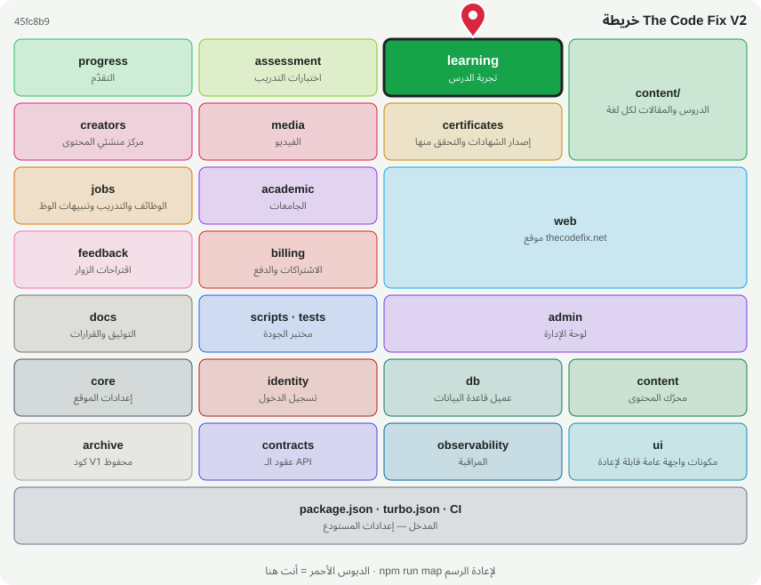

# 🎓 @tcf/learning

وحدة ميزة · تجربة الدرس: العرض، الملعب، المفضلة، آخر زيارة

<!-- map:start (generated by `npm run map` — edits inside are overwritten) -->
## 📍 أنت هنا

| | |
|---|---|
| النوع | وحدة ميزة |
| المكان | `modules/learning` |
| يعتمد على | `@tcf/content`، `@tcf/core`، `@tcf/observability`، `@tcf/progress` |
| يستخدمه | `@tcf/web`، `tests` |
| الحجم | 17 ملف · 1,242 سطر |
| ملاحظات الفحص | ✅ لا شيء |

### شو فيه

| المجلد | ملفات | ملاحظة |
|---|---:|---|
| `modules/learning/src/ui` | 15 |  |
| `modules/learning/src` | 1 |  |
| `modules/learning (package)` | 1 |  |

### الأكثر استخدامًا من الخارج

| الاستيراد | عدد المستوردين |
|---|---:|
| `@tcf/learning/ui/OnThisPage` | 2 |
| `@tcf/learning/ui/Mdx` | 2 |
| `@tcf/learning/ui/Sidebar` | 2 |
| `@tcf/learning/ui/Playground` | 2 |
| `@tcf/learning/ui/ArticleShare` | 1 |
| `@tcf/learning/ui/LessonComplete` | 1 |
| `@tcf/learning/ui/BookmarkButton` | 1 |
| `@tcf/learning/ui/LessonFeedback` | 1 |
| `@tcf/learning/ui/ReadingProgress` | 1 |
| `@tcf/learning/ui/RecordVisit` | 1 |
| `@tcf/learning/ui/LessonKeyNav` | 1 |
| `@tcf/learning/ui/TrackProgress` | 1 |

اسأل الخريطة عن أي ملف: `node scripts/audit/where.mjs <اسم الملف>`
<!-- map:end -->
