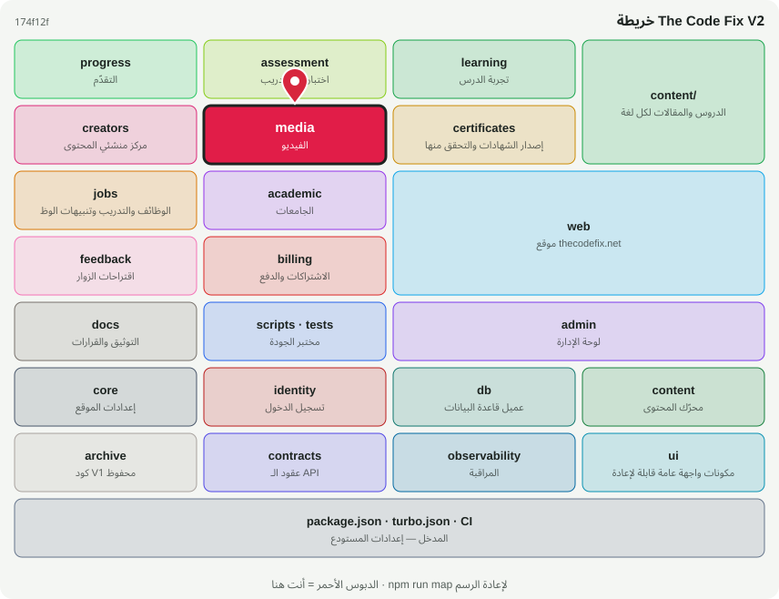

# 🎬 @tcf/media

وحدة ميزة · الفيديو: مزوّدات الاستضافة وتتبّع المشاهدة (جديد)

<!-- map:start (generated by `npm run map` — edits inside are overwritten) -->
## 📍 أنت هنا

| | |
|---|---|
| النوع | وحدة ميزة |
| المكان | `modules/media` |
| يعتمد على | `@tcf/content` |
| يستخدمه | `tests` |
| الحجم | 8 ملف · 249 سطر |
| ملاحظات الفحص | ✅ لا شيء |

### شو فيه

| المجلد | ملفات | ملاحظة |
|---|---:|---|
| `modules/media/src` | 2 | منطق الحزمة (سيرفر ومشترك) |
| `modules/media/src/providers` | 2 | مزوّدات قابلة للتبديل خلف واجهة واحدة |
| `modules/media (package)` | 3 | package.json · README · MAP.svg |
| `modules/media/src/ui` | 1 | مكونات الواجهة (React) — تُستورد كـ @tcf/<الحزمة>/ui/<الاسم> |

### الأكثر استخدامًا من الخارج

| الاستيراد | عدد المستوردين |
|---|---:|
| `@tcf/media/providers/youtube` | 1 |
| `@tcf/media/provider` | 1 |

اسأل الخريطة عن أي ملف: `node scripts/audit/where.mjs <اسم الملف>`
<!-- map:end -->
