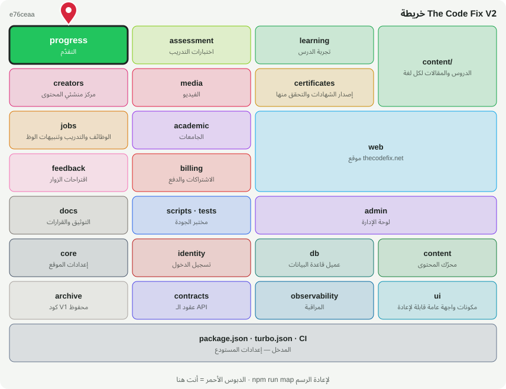

# 📈 @tcf/progress

وحدة ميزة · التقدّم، النقاط، الإنجازات، لوحة المتصدرين، لوحة الحساب

<!-- map:start (generated by `npm run map` — edits inside are overwritten) -->
## 📍 أنت هنا

| | |
|---|---|
| النوع | وحدة ميزة |
| المكان | `modules/progress` |
| يعتمد على | `@tcf/content`، `@tcf/core`، `@tcf/db`، `@tcf/identity`، `@tcf/observability`، `@tcf/ui` |
| يستخدمه | `@tcf/admin`، `@tcf/assessment`، `@tcf/certificates`، `@tcf/learning`، `@tcf/web`، `tests` |
| الحجم | 16 ملف · 1,883 سطر |
| ملاحظات الفحص | ✅ لا شيء |

### شو فيه

| المجلد | ملفات | ملاحظة |
|---|---:|---|
| `modules/progress/src/ui` | 5 |  |
| `modules/progress/src` | 9 |  |
| `modules/progress/src/actions` | 1 |  |
| `modules/progress (package)` | 1 |  |

### الأكثر استخدامًا من الخارج

| الاستيراد | عدد المستوردين |
|---|---:|
| `@tcf/progress/progress` | 6 |
| `@tcf/progress/points` | 3 |
| `@tcf/progress/leaderboard` | 2 |
| `@tcf/progress/recent` | 2 |
| `@tcf/progress/actions/progress` | 2 |
| `@tcf/progress/ui/AccountDashboard` | 1 |
| `@tcf/progress/ui/LeaderboardTabs` | 1 |
| `@tcf/progress/ui/ProgressSync` | 1 |
| `@tcf/progress/types` | 1 |
| `@tcf/progress/bookmarks` | 1 |
| `@tcf/progress/sanitize` | 1 |

اسأل الخريطة عن أي ملف: `node scripts/audit/where.mjs <اسم الملف>`
<!-- map:end -->
