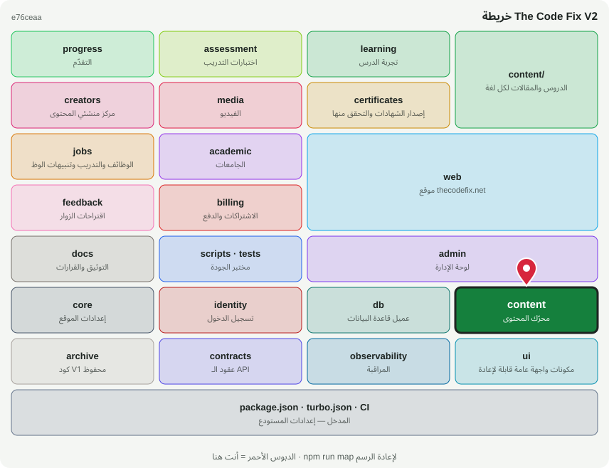

# ⚙️ @tcf/content

حزمة أساس · محرّك المحتوى: المسارات، الدروس، المدونة، المرجع، اللغات

<!-- map:start (generated by `npm run map` — edits inside are overwritten) -->
## 📍 أنت هنا

| | |
|---|---|
| النوع | حزمة أساس |
| المكان | `packages/content` |
| يعتمد على | `@tcf/db` |
| يستخدمه | `@tcf/academic`، `@tcf/admin`، `@tcf/assessment`، `@tcf/certificates`، `@tcf/jobs`، `@tcf/learning`، `@tcf/media`، `@tcf/progress`، `@tcf/web`، `tests` |
| الحجم | 16 ملف · 1,676 سطر |
| ملاحظات الفحص | ✅ لا شيء |

### شو فيه

| المجلد | ملفات | ملاحظة |
|---|---:|---|
| `packages/content/src` | 13 |  |
| `packages/content/src/admin` | 2 |  |
| `packages/content (package)` | 1 |  |

### الأكثر استخدامًا من الخارج

| الاستيراد | عدد المستوردين |
|---|---:|
| `@tcf/content/tracks` | 27 |
| `@tcf/content/seo` | 15 |
| `@tcf/content/admin/writer` | 11 |
| `@tcf/content/paths` | 8 |
| `@tcf/content/quizzes` | 7 |
| `@tcf/content/blog` | 7 |
| `@tcf/content/reference` | 6 |
| `@tcf/content/roadmaps` | 5 |
| `@tcf/content/admin/cms` | 3 |
| `@tcf/content/lesson-dates` | 3 |
| `@tcf/content/mdx-untrusted` | 3 |
| `@tcf/content/i18n` | 2 |

اسأل الخريطة عن أي ملف: `node scripts/audit/where.mjs <اسم الملف>`
<!-- map:end -->
