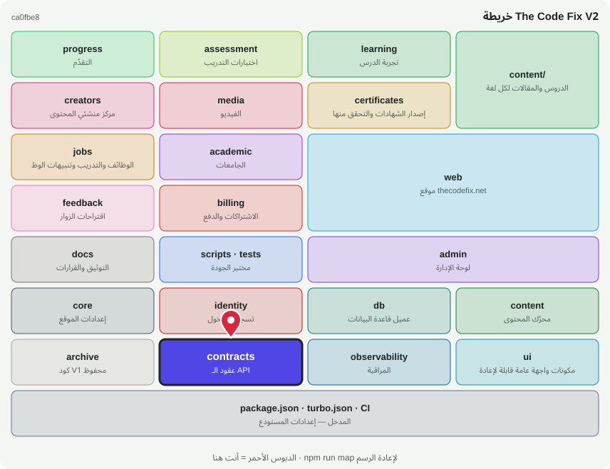

# 📜 @tcf/contracts

حزمة أساس · عقود الـ API (zod) المشتركة بين الويب والموبايل

<!-- map:start (generated by `npm run map` — edits inside are overwritten) -->
## 📍 أنت هنا

| | |
|---|---|
| النوع | حزمة أساس |
| المكان | `packages/contracts` |
| يعتمد على | لا شيء (أساس مستقل) |
| يستخدمه | `@tcf/web`، `tests` |
| الحجم | 4 ملف · 127 سطر |
| ملاحظات الفحص | ✅ لا شيء |

### شو فيه

| المجلد | ملفات | ملاحظة |
|---|---:|---|
| `packages/contracts/src` | 1 | منطق الحزمة (سيرفر ومشترك) |
| `packages/contracts (package)` | 3 | package.json · README · MAP.svg |

### الأكثر استخدامًا من الخارج

| الاستيراد | عدد المستوردين |
|---|---:|
| `@tcf/contracts/api-v1` | 2 |

اسأل الخريطة عن أي ملف: `node scripts/audit/where.mjs <اسم الملف>`
<!-- map:end -->
