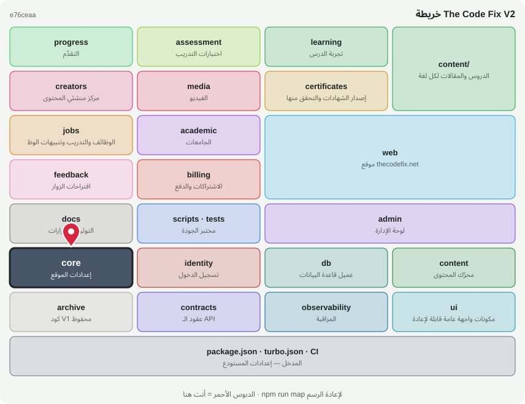

# 🧱 @tcf/core

حزمة أساس · إعدادات الموقع، الأعلام، التحقق، التشفير، الـ rate limit

<!-- map:start (generated by `npm run map` — edits inside are overwritten) -->
## 📍 أنت هنا

| | |
|---|---|
| النوع | حزمة أساس |
| المكان | `packages/core` |
| يعتمد على | لا شيء (أساس مستقل) |
| يستخدمه | `@tcf/academic`، `@tcf/admin`، `@tcf/assessment`، `@tcf/certificates`، `@tcf/creators`، `@tcf/feedback`، `@tcf/identity`، `@tcf/jobs`، `@tcf/learning`، `@tcf/progress`، `@tcf/ui`، `@tcf/web`، `scripts`، `tests` |
| الحجم | 8 ملف · 248 سطر |
| ملاحظات الفحص | 🔵 1 |

### شو فيه

| المجلد | ملفات | ملاحظة |
|---|---:|---|
| `packages/core/src` | 7 |  |
| `packages/core (package)` | 1 |  |

### الأكثر استخدامًا من الخارج

| الاستيراد | عدد المستوردين |
|---|---:|
| `@tcf/core/site` | 25 |
| `@tcf/core/flags` | 19 |
| `@tcf/core/rate-limit` | 19 |
| `@tcf/core/validation` | 5 |
| `@tcf/core/request-body` | 3 |
| `@tcf/core/crypto` | 3 |
| `@tcf/core/color` | 2 |

اسأل الخريطة عن أي ملف: `node scripts/audit/where.mjs <اسم الملف>`
<!-- map:end -->
