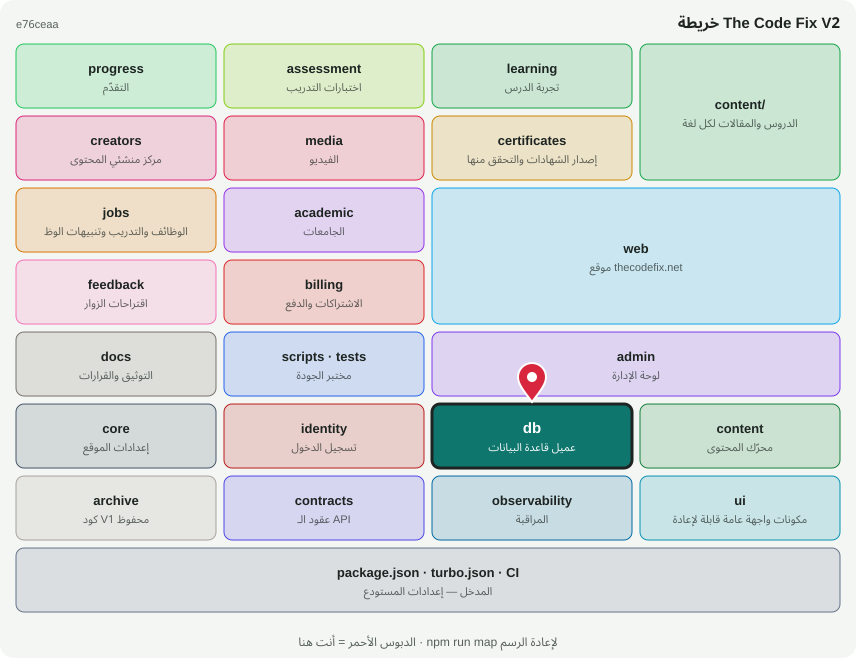

# 🗄️ @tcf/db

حزمة أساس · عميل قاعدة البيانات، الـ Schema المقسّم، الترحيلات

<!-- map:start (generated by `npm run map` — edits inside are overwritten) -->
## 📍 أنت هنا

| | |
|---|---|
| النوع | حزمة أساس |
| المكان | `packages/db` |
| يعتمد على | لا شيء (أساس مستقل) |
| يستخدمه | `@tcf/academic`، `@tcf/admin`، `@tcf/assessment`، `@tcf/billing`، `@tcf/certificates`، `@tcf/content`، `@tcf/creators`، `@tcf/feedback`، `@tcf/identity`، `@tcf/jobs`، `@tcf/progress`، `@tcf/web`، `scripts`، `tests` |
| الحجم | 81 ملف · 79,553 سطر |
| ملاحظات الفحص | ✅ لا شيء |

### شو فيه

| المجلد | ملفات | ملاحظة |
|---|---:|---|
| `packages/db/drizzle` | 62 | 30 ملف SQL مقفلة — لا تعدّل القديم أبدًا |
| `packages/db/src/schema` | 11 | 11 ملف، بدون أي تغيير SQL عن V1 |
| `packages/db/src` | 4 | منطق الحزمة (سيرفر ومشترك) |
| `packages/db (package)` | 4 | package.json · README · MAP.svg |

### الأكثر استخدامًا من الخارج

| الاستيراد | عدد المستوردين |
|---|---:|
| `@tcf/db/schema` | 65 |
| `@tcf/db` | 52 |
| `@tcf/db/errors` | 7 |

اسأل الخريطة عن أي ملف: `node scripts/audit/where.mjs <اسم الملف>`
<!-- map:end -->
