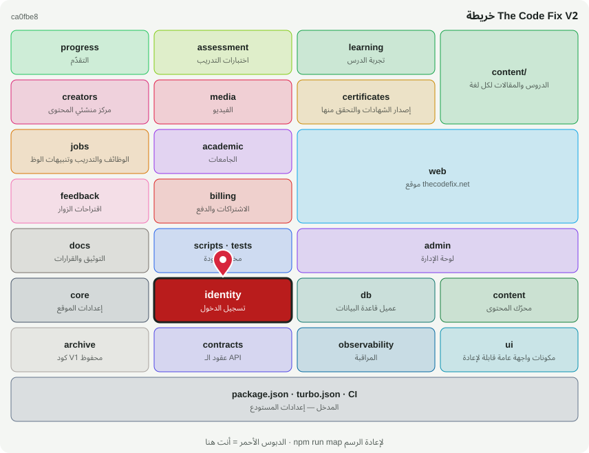

# 🔐 @tcf/identity

حزمة أساس · تسجيل الدخول (Auth.js)، الأدوار والصلاحيات، بوابة الإدارة

<!-- map:start (generated by `npm run map` — edits inside are overwritten) -->
## 📍 أنت هنا

| | |
|---|---|
| النوع | حزمة أساس |
| المكان | `packages/identity` |
| يعتمد على | `@tcf/core`، `@tcf/db` |
| يستخدمه | `@tcf/academic`، `@tcf/admin`، `@tcf/assessment`، `@tcf/certificates`، `@tcf/creators`، `@tcf/feedback`، `@tcf/jobs`، `@tcf/progress`، `@tcf/web`، `tests` |
| الحجم | 7 ملف · 398 سطر |
| ملاحظات الفحص | 🟡 1 🔵 1 |

### شو فيه

| المجلد | ملفات | ملاحظة |
|---|---:|---|
| `packages/identity/src` | 5 |  |
| `packages/identity/src/actions` | 1 |  |
| `packages/identity (package)` | 1 |  |

### الأكثر استخدامًا من الخارج

| الاستيراد | عدد المستوردين |
|---|---:|
| `@tcf/identity/rbac` | 45 |
| `@tcf/identity/admin-access` | 33 |
| `@tcf/identity/auth` | 31 |
| `@tcf/identity/authorization` | 12 |
| `@tcf/identity/actions/admin-session` | 3 |
| `@tcf/identity/admin-token` | 1 |

اسأل الخريطة عن أي ملف: `node scripts/audit/where.mjs <اسم الملف>`
<!-- map:end -->
