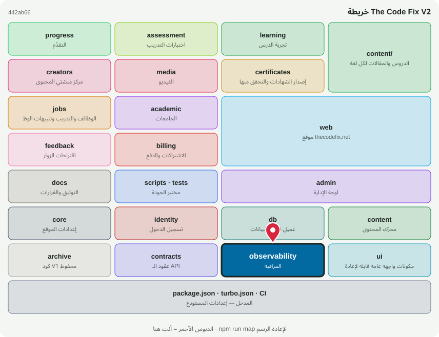

# 📡 @tcf/observability

حزمة أساس · المراقبة، تقارير CSP، أحداث التحليلات

<!-- map:start (generated by `npm run map` — edits inside are overwritten) -->
## 📍 أنت هنا

| | |
|---|---|
| النوع | حزمة أساس |
| المكان | `packages/observability` |
| يعتمد على | لا شيء (أساس مستقل) |
| يستخدمه | `@tcf/assessment`، `@tcf/billing`، `@tcf/certificates`، `@tcf/jobs`، `@tcf/learning`، `@tcf/progress`، `@tcf/ui`، `@tcf/web`، `tests` |
| الحجم | 7 ملف · 450 سطر |
| ملاحظات الفحص | ✅ لا شيء |

### شو فيه

| المجلد | ملفات | ملاحظة |
|---|---:|---|
| `packages/observability/src` | 6 |  |
| `packages/observability (package)` | 1 |  |

### الأكثر استخدامًا من الخارج

| الاستيراد | عدد المستوردين |
|---|---:|
| `@tcf/observability/analytics` | 20 |
| `@tcf/observability/monitoring` | 5 |
| `@tcf/observability/client-monitoring` | 3 |
| `@tcf/observability/analytics-contract` | 3 |
| `@tcf/observability/csp-report` | 2 |
| `@tcf/observability/monitoring-contract` | 2 |

اسأل الخريطة عن أي ملف: `node scripts/audit/where.mjs <اسم الملف>`
<!-- map:end -->
