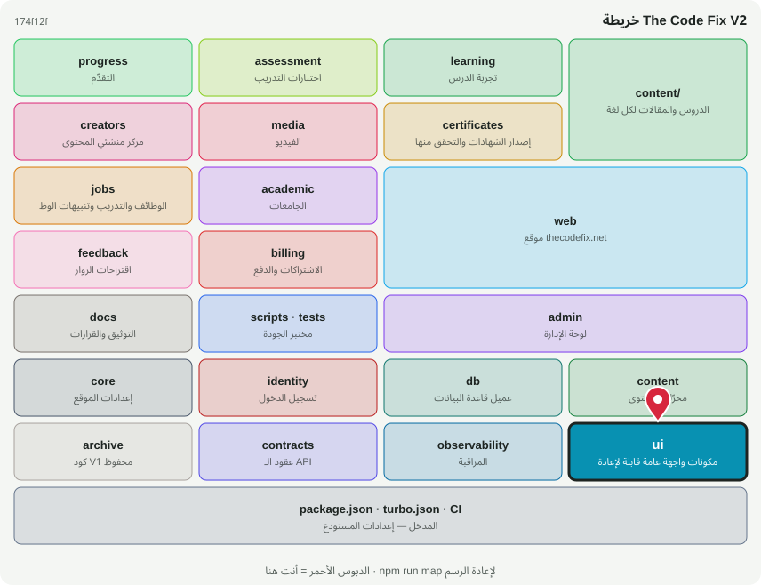

# 🧩 @tcf/ui

حزمة أساس · مكونات واجهة عامة قابلة لإعادة الاستخدام

<!-- map:start (generated by `npm run map` — edits inside are overwritten) -->
## 📍 أنت هنا

| | |
|---|---|
| النوع | حزمة أساس |
| المكان | `packages/ui` |
| يعتمد على | `@tcf/core`، `@tcf/observability` |
| يستخدمه | `@tcf/jobs`، `@tcf/progress`، `@tcf/web` |
| الحجم | 16 ملف · 527 سطر |
| ملاحظات الفحص | ✅ لا شيء |

### شو فيه

| المجلد | ملفات | ملاحظة |
|---|---:|---|
| `packages/ui/src/ui` | 13 | مكونات الواجهة (React) — تُستورد كـ @tcf/<الحزمة>/ui/<الاسم> |
| `packages/ui (package)` | 3 | package.json · README · MAP.svg |

### الأكثر استخدامًا من الخارج

| الاستيراد | عدد المستوردين |
|---|---:|
| `@tcf/ui/ui/JsonLd` | 16 |
| `@tcf/ui/ui/Breadcrumbs` | 12 |
| `@tcf/ui/ui/CountryFlag` | 6 |
| `@tcf/ui/ui/TrackedAnchor` | 4 |
| `@tcf/ui/ui/ExportButton` | 3 |
| `@tcf/ui/ui/ShareButton` | 2 |
| `@tcf/ui/ui/TrackedCta` | 2 |
| `@tcf/ui/ui/ThemeToggle` | 2 |
| `@tcf/ui/ui/TableFilter` | 1 |
| `@tcf/ui/ui/ScrollToTop` | 1 |
| `@tcf/ui/ui/TextSizeControl` | 1 |
| `@tcf/ui/ui/PrintButton` | 1 |

اسأل الخريطة عن أي ملف: `node scripts/audit/where.mjs <اسم الملف>`
<!-- map:end -->
